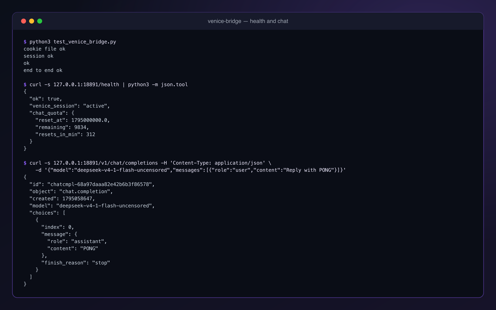
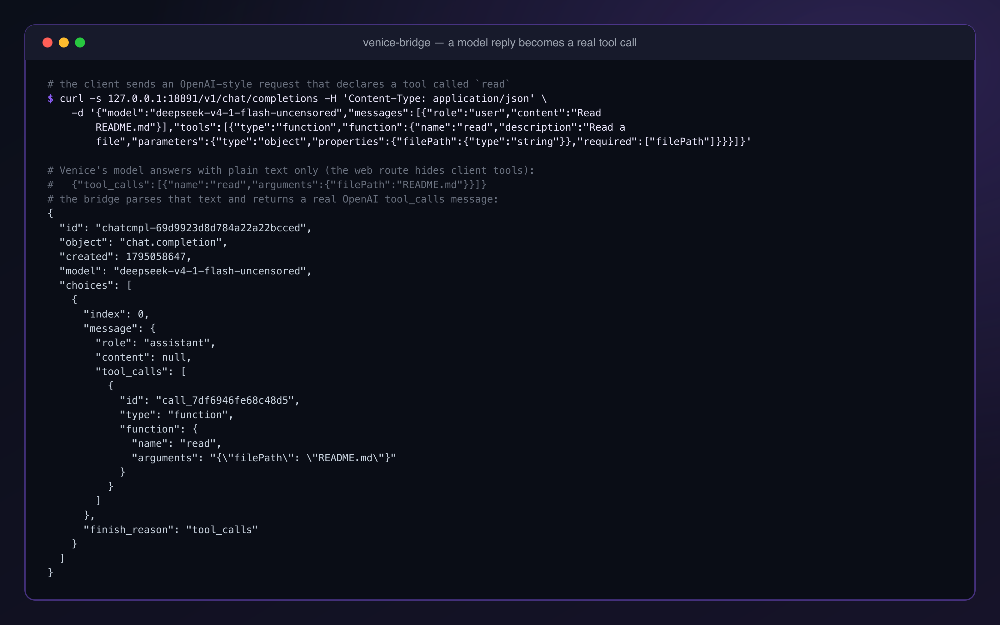

<p align="center"></p>

<p align="center">
  
  
  <a href="LICENSE"></a>
  
  <a href="AGENTS.md"></a>
  
</p>

<p align="center">
  <code>venice-ai</code> <code>opencode</code> <code>openai-compatible</code> <code>tool-calling</code>
  <code>llm-proxy</code> <code>venice-api-alternative</code> <code>coding-agent</code> <code>local-bridge</code>
  <code>macos</code> <code>python</code>
</p>

venice-bridge is a free, open-source local bridge for macOS that lets OpenCode and other OpenAI-compatible coding agents use a venice.ai web subscription, with working tool calls.

It is one Python file (`venice_bridge.py`) plus a tolerant tool-call parser (`tolerant_parser.py`). It runs an
OpenAI Chat Completions server on `127.0.0.1:18891` and forwards each request to the backend of the venice.ai
web app, signed in with your own browser login. It does not use the paid Venice API and needs no API key.

Documentation site: <https://nsozturk.github.io/venice-bridge/> · Agent contract: [AGENTS.md](AGENTS.md)

> [!WARNING]
> **Unofficial. Read this before you use it.**
> - venice-bridge is not affiliated with, endorsed by, or supported by Venice.ai. It talks to undocumented web
>   endpoints that can change or break at any time.
> - It automates your own logged-in web session. That may be against Venice's terms of service. You use it at
>   your own risk, with your own account. Do not share cookies or accounts.
> - It needs a paid Venice web plan (Pro). On a free account the route answers `403 creator_access_required`.
> - macOS only so far. No Anthropic Messages API and no OpenAI Responses API. No images. In tools mode, short
>   replies are not streamed as they are written.
> - Tool calling is emulated in text. Open models sometimes need a retry.

## Screenshots

<p align="center">
  
</p>

<table>
  <tr>
    <td width="50%"></td>
    <td width="50%">A request that declares a <code>read</code> tool. The Venice model answers in plain text; the bridge
    parses that text and returns a standard OpenAI <code>tool_calls</code> message, which is what OpenCode runs.</td>
  </tr>
</table>

## Requirements

| Item | Notes |
|---|---|
| macOS | The system `curl` is used for the chat stream because it passes Cloudflare. Linux and Windows are untested. |
| Python 3.10+ | With `curl_cffi` (`pip install curl_cffi`, or `pip install -r requirements.txt`). |
| A paid venice.ai web plan (Pro) | Logged in on venice.ai in your browser. A free account gets `403 creator_access_required`. |
| OpenCode, or another client | Anything that speaks OpenAI Chat Completions (`POST /v1/chat/completions`). |

## Quick start

### 1. Save your venice.ai login cookie

The bridge needs the value of the `__client` cookie of `clerk.venice.ai`. This is a long-lived login cookie; from
it the bridge mints a short-lived (about 60 s) session token and a client attestation for every request window.

1. Log in on venice.ai in Chrome.
2. Open DevTools → **Application** → **Cookies** → `https://clerk.venice.ai`.
3. Copy the **Value** of `__client`.
4. Save it to the cookie file:

```bash
mkdir -p ~/.config/venice-bridge && pbpaste > ~/.config/venice-bridge/client-cookie.txt && chmod 600 ~/.config/venice-bridge/client-cookie.txt
```

The file may hold the bare value or a pasted `__client=<paste the cookie value>;` string. The cookie is a live
credential for your Venice account: never commit it and never share it.

### 2. Run the bridge

```bash
pip install curl_cffi
python3 venice_bridge.py            # options: --host, --port (default 127.0.0.1:18891)
```

### 3. Check it

```bash
curl -s http://127.0.0.1:18891/health
```

A working setup answers `200` with `"ok": true`, `"venice_session": "active"` and the remaining web chat quota.
If the login is missing or rejected it answers `503` with `"ok": false` and the reason.

### 4. Add the provider to OpenCode

Copy the provider block from [`examples/opencode.json`](examples/opencode.json) into
`~/.config/opencode/opencode.json` (or a project `opencode.json`). The example lists nine models; this is the
same block with one of them:

```json
{
  "$schema": "https://opencode.ai/config.json",
  "provider": {
    "venice-bridge": {
      "npm": "@ai-sdk/openai-compatible",
      "name": "Venice Web (local bridge)",
      "options": {
        "baseURL": "http://127.0.0.1:18891/v1",
        "apiKey": "local"
      },
      "models": {
        "deepseek-v4-1-flash-uncensored": {
          "name": "DeepSeek V4.1 Flash Uncensored (Venice Web)",
          "modalities": { "input": ["text"], "output": ["text"] },
          "limit": { "context": 524288, "output": 131072 }
        }
      }
    }
  }
}
```

`apiKey` is a placeholder; the bridge does not read it.

### 5. First run

```bash
opencode -m venice-bridge/deepseek-v4-1-flash-uncensored
```

Models in the example config: `deepseek-v4-1-flash-uncensored`, `deepseek-v4-1-flash`, `z-ai-glm-5-3-flash`,
`kimi-k2-5`, `default` (Venice "Auto"), `qwen3-coder-480b-a35b-instruct-turbo`, `qwen3-6-27b`, `zai-org-glm-5.2`,
`venice-uncensored-1-2`. `GET /v1/models` lists whatever your account's web catalogue offers without credits.

## Autostart with launchd

[`examples/com.example.venice-bridge.plist`](examples/com.example.venice-bridge.plist) is a launchd template that
starts the bridge at login and restarts it if it exits.

1. Replace every `/PATH/TO` with real absolute paths (your `python3` and this folder).
2. Copy it to `~/Library/LaunchAgents/`.
3. Load it:

```bash
launchctl bootstrap gui/$(id -u) ~/Library/LaunchAgents/com.example.venice-bridge.plist
```

The template writes its log to `venice_bridge.log` in this folder. Because the template sets `KeepAlive`, a
killed process is started again; unload it with
`launchctl bootout gui/$(id -u)/com.example.venice-bridge` to stop it.

## How it works

```text
 OpenCode / any OpenAI client
        │  POST /v1/chat/completions  (OpenAI format, tools)
        ▼
 venice-bridge  127.0.0.1:18891
        │  1. __client cookie ──► clerk.venice.ai      (session id, ~60 s session JWT)
        │  2. JWT ─────────────► outerface.venice.ai  (client attestation)
        │  3. chat request ────► outerface.venice.ai/api/inference/chat/agents/ad-hoc
        ▼
 Venice web models  ──►  SSE stream  ──►  bridge  ──►  OpenAI chunks / tool_calls back to the client
```

Venice's web routes do not show client-declared tools to the model (a declared `bash` tool was measured to be
invisible on both `/agents/ad-hoc` and `/agents/venice`). The bridge therefore emulates tool calling in text:

- **Tool emulation.** The tool list goes into the system prompt: built-in tools and tools already used in the
  conversation with a compact full JSON schema, the rest as one-liners, inside a 78,000-character budget. A real
  OpenCode request measured 411 tools and about 441,000 characters of system prompt. The model answers
  `{"tool_calls":[{"name":"...","arguments":{...}}]}`; a format reminder with one example is appended as the last
  user message.
- **Tolerant parser.** `tolerant_parser.py` (a port of opencode-venice-web's parser, MIT) reads calls that are
  bare, fenced, after prose, in several envelopes, or structurally broken (8 of 8 real malformed replies in the
  fixtures). A second reader handles `<tool_calls>{"name":...,"arguments":...}</tool_calls>` with unescaped
  quotes in file content.
- **Completion check.** A reply counts only after Venice sends `response.completed`, so a cut stream never
  becomes a half-written file.
- **Server-loop cut.** Venice sometimes takes a model's native tool call for one of its own server tools and
  answers the model "Tool not found" in a loop. The bridge tolerates 3 such steps, then cuts the response and
  retries with a corrective reminder.
- **Retries.** In-bridge retries (budget 2) for a server loop, an unreadable call, an empty reply, or a broken
  stream.
- **Judge.** A small model (`qwen3-5-35b-a3b` by default) checks short turn endings after a tool result for early
  stops, such as a reply that only announces the next step. Disable it with `VENICE_BRIDGE_JUDGE=0`.
- **Stream gate.** With tools, a prose reply longer than 200 characters is streamed while it is written; anything
  that may still become a tool call is held back. Failures before the status line are returned as HTTP 502,
  because OpenCode retries a 502 but not an error inside a started stream (measured).
- **Error mapping.** Quota used up → 403 `venice_quota_exhausted` with the reset time (OpenCode retries a 429
  silently); a passing rate limit → 429; request too large (Venice 413) → 400 `context_length_exceeded`;
  Cloudflare challenge → 502 with a clear message.

Clerk rotates the `__client` cookie while it is used. The bridge saves the rotated value to
`~/.config/venice-bridge/rotated-client.json` (mode 0600) and keeps using it across restarts.

## Configuration

Environment variables are read when the bridge starts. Set them before you start it.

| Variable | Default | Purpose |
|---|---|---|
| `VENICE_BRIDGE_COOKIE_FILE` | `~/.config/venice-bridge/client-cookie.txt` | File holding the `__client` cookie value. |
| `VENICE_BRIDGE_SESSION_DIR` | empty (off) | Folder with a `client.py` exposing `get_session(domain)` that returns `{"timestamp": <ms>, "tokens": {"clerk_client": "<value>"}}`, for a local session daemon. Used when the cookie file is missing or empty. |
| `VENICE_BRIDGE_CLIENT_FILE` | `~/.config/venice-bridge/rotated-client.json` | Where the rotated cookie is saved (mode 0600). |
| `VENICE_BRIDGE_FORMAT_RETRIES` | `2` | In-bridge retries for server loops, unreadable calls, empty replies and broken streams. |
| `VENICE_BRIDGE_JUDGE` | on | `0` turns the early-stop judge off. |
| `VENICE_BRIDGE_JUDGE_MODEL` | `qwen3-5-35b-a3b` | Model used by the judge. |
| `VENICE_BRIDGE_JUDGE_RETRIES` | `1` | Retries the judge may add per turn. |

Command-line options: `--host` (default `127.0.0.1`) and `--port` (default `18891`). Keep the host on loopback:
the bridge has no client authentication (see [SECURITY.md](SECURITY.md)).

## API

| Method and path | Purpose | Status codes |
|---|---|---|
| `POST /v1/chat/completions` | OpenAI Chat Completions, streaming and non-streaming, with `tools` / `tool_calls`. | `200`; `400` invalid JSON or `context_length_exceeded`; `402` plan or credits; `401`/`403` Venice refusal; `403` quota used up; `429` passing rate limit; `502` upstream or bridge failure |
| `GET /v1/models` | Models the account's web catalogue offers without credits. | `200`; `502` |
| `GET /health` | Session state and remaining web chat quota. | `200`; `503` no usable login |
| `POST /reload` | Drops cached auth (cookie, session, token, attestation) and the local quota lock. | `200` |

Any other path answers `404`.

## Measured performance

Measured in November 2026 on one machine with one account. These are observations, not guarantees.

- Bridge overhead per request: about 21 ms with a 441k-character prompt and 401 tools (against a local fake
  upstream).
- A short model step through the bridge: 1.5–3 s. A warm OpenCode session: 2.8–4.5 s per message.
- Calls that Venice swallows cost roughly 20–45 % of bridge time on models that prefer native tool calls.

Small-project benchmark: OpenCode builds a Python todo CLI with tests and a README from one prompt. Wall time
includes OpenCode's own startup.

| Model id | Result | Time |
|---|---|---:|
| `deepseek-v4-1-flash-uncensored` | working project | 43–63 s |
| `deepseek-v4-1-flash` | working project (after the tagged-call reader was added) | 63–114 s |
| `z-ai-glm-5-3-flash` | working project | 88 s |
| `qwen3-coder-480b-a35b-instruct-turbo` | working project | 123 s |
| `kimi-k2-5` | working project | 119–139 s |
| `default` (Venice "Auto") | working project | 336 s (63 steps) |

## Troubleshooting

| Symptom | Cause | Fix |
|---|---|---|
| `403` with "Venice rejected the request (403): creator_access_required" | The account is on a free plan; the web agent route needs a paid plan. | Use an account with a paid Venice web plan (Pro). |
| `403` with `error.type` `venice_quota_exhausted` and "Resets in about N min" | The web chat quota of the account is used up. The bridge answers locally until the reset. | Wait for the reset. `GET /health` shows the remaining quota and the reset time. |
| `429` with `error.type` `venice_rate_limited` | A passing Venice rate limit while quota is left. | Retry after a short wait; clients usually back off on their own. |
| `502` with "Cloudflare challenged the request" | Cloudflare challenged the upstream call. | Open venice.ai in your browser, refresh the cookie file (or sync your session daemon), then retry. |
| "No venice.ai login found" (`503` on `/health`, `502` on chat) | The cookie file is missing or empty and no session daemon is configured. | Save the cookie as in [Quick start](#1-save-your-veniceai-login-cookie), or set `VENICE_BRIDGE_COOKIE_FILE`. |
| "Clerk ... rejected" or "token mint failed" | The saved cookie is no longer valid. | Log in on venice.ai again, save a fresh cookie, then `curl -s -X POST http://127.0.0.1:18891/reload`. |
| `400` with `context_length_exceeded` | The request is larger than Venice accepts (Venice 413). | Start a new session or compact the conversation; use a model with a larger context. |
| `402` "Your Venice plan or credits do not cover this model" | The model needs credits or a higher plan. | Pick a model that `GET /v1/models` lists. |
| The model says its tools are unavailable or broken | Venice took the model's native tool call for one of its own server tools and answered "Tool not found". The bridge cuts this after 3 steps and retries, within its budget. | Send the message again, or use a model that follows the JSON call format well (see the benchmark). Keep the judge on (`VENICE_BRIDGE_JUDGE` not `0`). |

The bridge logs to stderr (or to `venice_bridge.log` under the launchd template). Lines start with
`[venice-bridge]` and include upstream status codes and per-request timing.

## FAQ

### Does it need a Venice API key?

No. It uses the venice.ai web app's own backend with your browser login (the `__client` cookie). It does not
call the paid Venice API. The `apiKey` value in the OpenCode config is a placeholder.

### Does it work on a free Venice account?

No. The web agent route it uses answers `403 creator_access_required` on a free account. A paid web plan (Pro) is
required.

### Does it work with Claude Code or Codex?

Not directly. The bridge speaks only OpenAI Chat Completions. It does not implement Anthropic Messages
(`/v1/messages`), which Claude Code uses, or OpenAI Responses (`/v1/responses`), which Codex CLI uses.

### Does it work on Linux or Windows?

Untested. It relies on the system `curl` to pass Cloudflare, and that has only been verified on macOS.

### Is this allowed by Venice?

venice-bridge is unofficial and uses undocumented web endpoints. Automating your logged-in web session may be
against Venice's terms of service. Use it at your own risk, with your own account only, and do not share cookies
or accounts.

### Where do my chats go?

From the bridge, requests go only to Venice (`clerk.venice.ai` for login, `outerface.venice.ai` for models, quota
and chat), under your own account. With the judge on, a short extra request per checked turn also goes to Venice.
The bridge keeps only the rotated login cookie on disk; each upstream call writes its headers and body to a
private temporary folder that is removed when the call ends. Its log records request sizes, timing, status
codes and short fragments of Venice's own tool steps. How Venice stores chats is governed by Venice, not by this
project.

### Is it an alternative to opencode-venice-web?

It solves the same problem in Python instead of Node. opencode-venice-web is the most mature Venice web proxy and
sends full schemas for every tool; venice-bridge sends full schemas only for built-in and already-used tools and
one-liners for the rest, to fit large tool lists. Its tolerant parser is a port of opencode-venice-web's.

## Alternatives / compared with

| Project | What it is |
|---|---|
| [CanArslanDev/opencode-venice-web](https://github.com/CanArslanDev/opencode-venice-web) | Node. The most mature Venice web proxy; sends full schemas for every tool. |
| [aintlikeu/unofficial-venice-proxy](https://github.com/aintlikeu/unofficial-venice-proxy) | Another Venice web proxy. |
| [zalo-alex/venice-opencode](https://github.com/zalo-alex/venice-opencode) | Another Venice web proxy. |
| Official Venice API | Paid, metered credits with an API key; OpenCode has a built-in `venice` provider for it. |

## Tests

```bash
python3 test_venice_bridge.py
```

The self-check runs offline: it uses temporary files and a fake Venice server on localhost, never the real Venice
endpoints. Success prints these lines and exits with status 0:

```text
cookie file ok
session ok
ok
end to end ok
```

A failure stops with an `AssertionError` traceback and a non-zero exit status.

## Credits

`tolerant_parser.py` is a Python port of the tolerant tool-call parser of
[opencode-venice-web](https://github.com/CanArslanDev/opencode-venice-web), and the malformed-reply fixtures come
from the same project; several reminder texts and the judge prompt are adapted from it. All are used under the MIT
License. See [NOTICE.md](NOTICE.md) and
[THIRD_PARTY_LICENSE-opencode-venice-web.txt](THIRD_PARTY_LICENSE-opencode-venice-web.txt).

## License

[MIT](LICENSE) © 2026 venice-bridge contributors.
